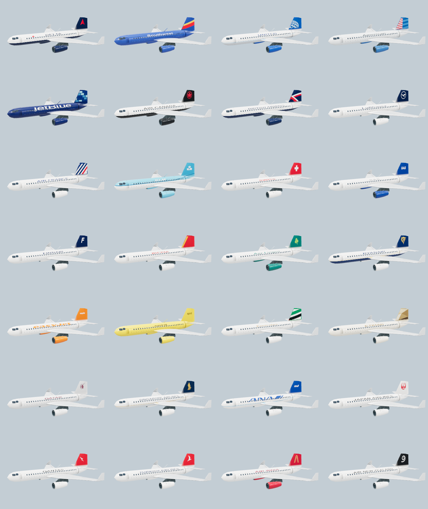
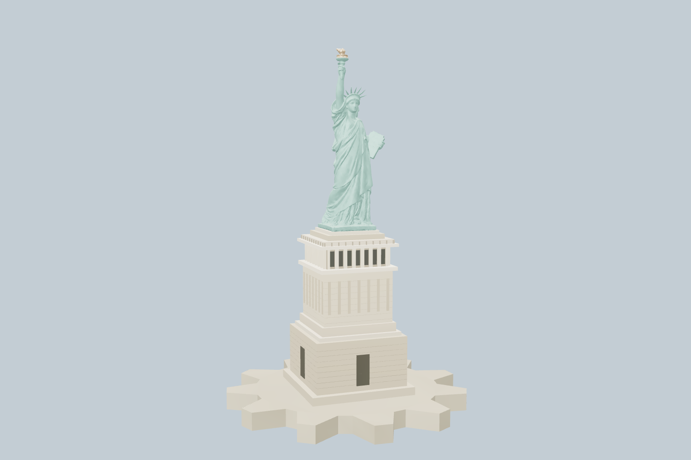

# Commercial liveries and Liberty — 2026-10-31

Implemented on the existing `main` checkout. **Enabled by default** at the
owner's explicit request on 2026-10-31 ("push to main and enable the flags etc").
`COMMERCIAL_PAINT`, `OPERATOR_LIVERIES`, `LIBERTY_DETAIL` and the subsequent
`LANDMARK_FIDELITY` pass now need no preview query. One-load rollback:

`/?flags=-COMMERCIAL_PAINT,-OPERATOR_LIVERIES,-LIBERTY_DETAIL,-LANDMARK_FIDELITY`

## Aircraft

- **36 new selectable commercial finishes:** 28 passenger airlines on the
  Stratoliner, six cargo operators on the Leviathan, and British Airways / Air
  France on Concorde. The existing 39 original presets remain valid.
- Passenger airlines: Delta, Southwest, United, American, JetBlue, Air Canada,
  British Airways, Lufthansa, Air France, KLM, Swiss, SAS, Finnair, Iberia,
  Aer Lingus, Ryanair, easyJet, Spirit, Emirates, Etihad, Qatar, Singapore,
  ANA, Japan Airlines, Qantas, Turkish, Air India and Air New Zealand.
- Cargo: FedEx, UPS, Atlas Air, Cargolux, DHL and Amazon Air.
- Player paint now has full-color 2048×1024 mipmapped artwork with separate
  fuselage, belly, wing, engine and tail colors. Transparent cabin windows,
  doors, authored material detail and moving control surfaces are retained.
  The selected aircraft owns one atlas and disposes it when the finish changes.
- Vector emblems replace the generic two-letter tails. Simple Icons masters
  and first-party tail graphics share one drawing module with live traffic;
  the traffic renderer retains its single shared atlas and instancing.
- These are representative schemes on Skyloom airframes, not exact
  registration-specific airline/aircraft replicas. The 63-record live traffic
  resolver and its conservative callsign behavior remain intact.
- Searchable picker, real tail swatches, scrolling rows, keyboard navigation
  and saved/backup-safe stable IDs. The expanded phone picker leaves the
  aircraft visible. Flag-off hides commercial choices but retains saved IDs
  and shows house colors until the flag is re-enabled.

## Statue of Liberty

The old 2,458-triangle figure is retained as the flag-off model. The replacement
uses jerryfisher's CC BY 4.0 photogrammetry of a nineteenth-century bronze
model, with authored verdigris copper, a gold flame, a stepped Hunt pedestal,
loggia windows/columns, masonry courses, observation parapets and Fort Wood.
This is a replica scan, not an on-site scan of the actual island.

| Detail | Triangles | Bytes |
| --- | ---: | ---: |
| Far / low tier | 4,504 | 167,048 |
| Medium / phone | 16,988 | 735,120 |
| High / close desktop | 51,992 | 1,785,244 |

Source geometry is 93 m tall: 46.05 m sculpture plus 46.95 m pedestal and
foundation. The game deliberately applies **1.4× additional presentation
scale** over the existing landmark boost, giving 175.77 scene-metre displayed
height. The source dimensions and POI facts stay unchanged. The procedural
fallback and label clearance use the same multiplier. The existing static
worker exclusion stays 60 m; the preview never mutates the worker manifest.
The normal landmark cache, prefetch and two-detail-model limits still apply.

## Verification

- `node scripts/verify-liveries.mjs`: **29/29**. Every original and commercial
  save choice round-trips; all 13 airframes, desktop and mobile geometry,
  retain independent resources, material roles and control-surface paint.
- `node scripts/verify-operator-liveries.mjs`: **8/8**.
- `node scripts/verify-landmark-details.mjs`: **16/16**, existing landmark
  budgets/cache/retry/placement behavior preserved.
- `node scripts/verify-commercial-liberty.mjs`: commercial catalogue counts,
  flag-off fallback, worker-manifest immutability, enlarged label clearance,
  all three GLB hashes/bounds/material attributes and budgets pass.
- `node scripts/build-liberty-detail.mjs --source=<credited GLB> --check`:
  all three files reproduce byte-for-byte. Source is SHA-256 pinned.
- `node scripts/review-commercial-liberty.cjs`: all 36 new paints captured,
  port/starboard closeups, mobile airframe, Liberty before/far/medium/high and
  night; **zero shader/runtime errors**. Four compiled material programs and
  six textures after switches in the isolated review scene.
- `FLY_COMMERCIAL_PAINT=1 node scripts/review-operator-liveries.cjs --channel chrome`:
  **89 shader combinations in each flag arm**, nine comparison cases, unknown
  operator unchanged, zero errors.
- `node scripts/verify-commercial-liberty-browser.cjs`: **desktop and phone
  PASS** for search/empty state, row bounds, persistence and keyboard controls.
  Desktop also verifies that the selected United paint reaches the flying
  aircraft and that Liberty loads at **high detail, 51,992 triangles**, with
  the intended 175.77 scene-metre display height on Liberty Island.
- Scoped ESLint and `git diff --check`: pass.
- `node scripts/verify-import-integrity.mjs`: **4/4**, including the 1,297-file
  undefined-identifier sweep.
- Production webpack build: **PASS**. The restricted Windows process hit
  `EPERM` while creating generated folders; the same build completed outside
  that restriction, including all ten static pages and build tracing.

These browser checks ran in Chrome on the **local RTX 5080** (ANGLE D3D11).
The phone check is **390×844 browser emulation, not a physical iPhone**.
This pass makes no frame-time or long-flight performance claim. The first
desktop full-catalogue UI run was interrupted by dev HMR; the final targeted
browser run above passed after editing stopped. The earlier phone full-catalogue
run selected/saved/reloaded all 45 airliner/cargo/Concorde finishes; the final
run additionally asserts that rows do not overlap and the preview stays visible.

Evidence: `docs/reviews/commercial-liberty/browser-report.json`, the images in
that directory, and the generated `.graphics-review/commercial-liberty/` and
`.graphics-review/operator-liveries/` review output. Asset attribution is in
`CREDITS.md`, the in-app asset inventory, and `public/licenses/`.

The owner authorized shipping with all four defaults enabled. Physical iPhone
flybys, low-tier LOD and repeated flight/hangar switches remain unmeasured;
the automated phone evidence above is browser emulation.

Enabled-default production verification: **desktop and phone PASS** without
any feature flags in the URL. Search, persistence, keyboard controls and row
bounds pass; desktop also confirms United paint reaches the flying aircraft
and Liberty has the enlarged display height. Quality is held for the visual
assertions. See `docs/reviews/commercial-liberty/shipping-defaults-report.json`
and `FLY_LANDMARK_FIDELITY.md` for the production diagnostics-gate correction.
