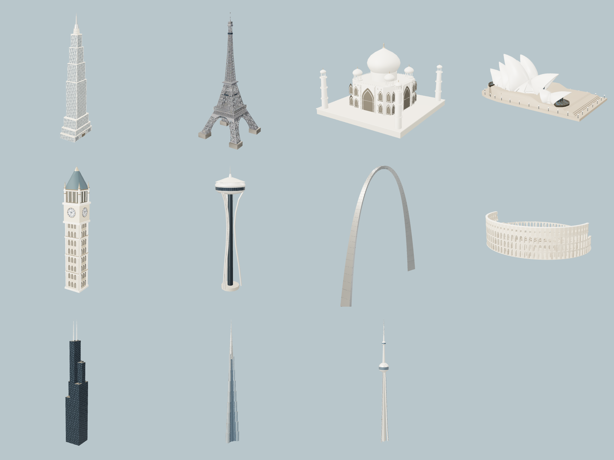
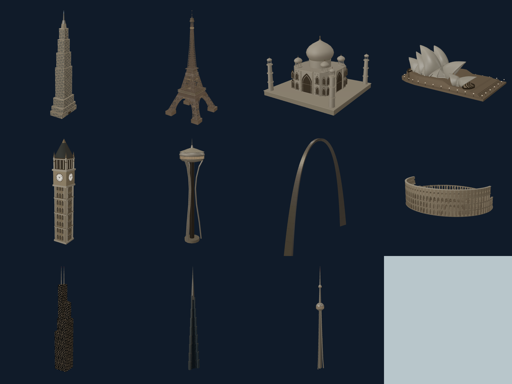

# Landmark fidelity — 2026-10-31

All eleven other marquee landmarks now have new far, medium and high models.
The Statue of Liberty from `FLY_COMMERCIAL_AND_LIBERTY.md` keeps its separate
asset family. Work is in the existing `main` checkout.

**Shipping state: ON**, enabled at the owner's explicit request on 2026-10-31
("push to main and enable the flags etc"). All four flags —
`LANDMARK_FIDELITY`, `LIBERTY_DETAIL`, `COMMERCIAL_PAINT` and
`OPERATOR_LIVERIES` — are enabled on a plain page load. For one-load rollback,
use `/?flags=-LANDMARK_FIDELITY,-LIBERTY_DETAIL,-COMMERCIAL_PAINT,-OPERATOR_LIVERIES`.

## Architecture

| Landmark | Changes | High-detail triangles |
| --- | --- | ---: |
| Empire State Building | Limestone setbacks, recessed glazing, floor framing, observatory and mast | 23,634 |
| Willis Tower | Nine staggered tubes, facade grid, rooftop equipment and twin masts | 37,620 |
| CN Tower | Triangular fluted shaft, elevator tracks, glazed observation decks and antenna | 9,848 |
| Space Needle | Open paired supports, waist bracing, glazed saucer and roof | 7,360 |
| Burj Khalifa | Rounded Y-plan wings, stepped setbacks, floor bands and metal fins | 47,664 |
| Taj Mahal | Chamfered main body, layered pointed portals, domes, minarets and balcony details | 26,300 |
| Big Ben / Elizabeth Tower | Blue-and-gold clock dials, Roman numerals, ticks and hands, Gothic openings and roof | 28,356 |
| Gateway Arch | Tapered triangular cross-section, panel seams and observation slits | 4,668 |
| Sydney Opera House | Restored licensed shell geometry, glazing, podium, stairs and material separation | 54,915 |
| Colosseum | Open arcades, columns, broken outer wall, inner seating and exposed hypogeum | 56,944 |
| Eiffel Tower | Detailed lattice, platform railings, glazed pavilions and iron/glass separation | 57,287 |

These are architectural interpretations for flight scenery. They are not
survey-grade replicas or photogrammetry. The Opera House restores the original
licensed source behind the previous simplified model; Eiffel's high model
extends the existing credited structure. Other geometry is authored locally.



Each asset has vertex albedo, roughness, metalness and explicit night-light
masks. Stone, metal, ceramic and glazing respond separately to the existing
cinematic material. The legacy procedural clock/window masks are disabled for
these assets so they cannot paint over the new geometry.



## Streaming and budgets

- 33 local, textureless GLBs; one merged mesh per landmark at each level.
- Far models stay below 10,000 triangles / 2 MiB; medium below 20,000 / 2 MiB;
  high below 60,000 / 4 MiB. The largest high download is the Colosseum at
  approximately 3.72 MiB. No third-party request is made at runtime.
- Existing two-active-detail, four-cached-detail and two-download limits remain.
- Runtime resolution preserves the static manifest, worker exclusions,
  landmark height, position and presentation scale. Liberty's separate boost
  remains unchanged. Low tier uses the new far model.
- All LOD footprints differ by less than 8% from their high-detail model.
- Source credits live in the GLB metadata, in-app asset inventory,
  `CREDITS.md` and `public/licenses/landmark-fidelity.md`.

## Rebuild

```sh
node scripts/fetch-landmark-fidelity-sources.mjs
node scripts/build-landmark-fidelity.mjs
node scripts/build-landmark-fidelity.mjs --check
```

The fetch step is an offline authoring prerequisite for the Opera House only;
it downloads two SHA-256-pinned resources into the ignored review directory.
Eiffel uses the already tracked, hash-pinned source GLB. All other models are
deterministically generated by `scripts/landmark-fidelity/`.

## Verification

- `verify-landmark-fidelity.mjs`: all 33 hashes, byte counts, geometry bounds,
  finite attributes, unit normals, non-degenerate triangles, licenses and
  budgets pass. Also checks flag-off identity, idempotent resolution, Liberty
  isolation, immutable worker exclusions and baked material attribute routing.
- `build-landmark-fidelity.mjs --check`: all 33 files reproduce byte-for-byte.
- Existing `verify-landmark-details.mjs`: **16/16**. Existing commercial/Liberty
  verification passes with the new family present.
- `review-landmark-fidelity.cjs`: **55 cases**, covering all eleven original,
  far, medium, high and night models, plus individual closeups; zero browser
  or shader errors. One compiled material program; two environment textures.
- Scoped ESLint and import-integrity: pass; the import sweep checks 1,309 files.
- Production webpack build: **PASS**, including all ten static pages and build
  tracing. The existing `metadataBase` warning is unrelated to these assets.
- `verify-landmark-fidelity-browser.cjs`: **16/16** world cases: eleven high
  desktop placements, three medium phone placements (Opera House, Big Ben and
  Colosseum), plus desktop and phone low-tier transitions. Zero browser/shader
  errors; active detail and cache limits hold.
- Production HTTP check: page returns 200; all 33 served GLBs match the recorded
  hashes. Local production preview is `http://localhost:3163/`; no feature query
  is required after the enabled-default rebuild.

Browser graphics run on local Chrome / **RTX 5080**, not SwiftShader. Phone
layout uses a **390×844 browser viewport**, not a physical iPhone. World
comparison holds the camera pose, local-noon lighting and governor tier;
explicit high/medium-to-low transitions are checked separately. These runs
test model placement, LOD resolution and cache bounds. They do not certify
settled terrain, frame times or long-flight performance.

The first world run passed eight desktop sites, then the unpinned governor
changed Willis from high to medium between the wait and the assertion. The
final visual harness holds the governor, as the existing world-art harness
does, and records that pin. No production governor behavior was changed.

The first production build hit Windows `EPERM` while creating Next.js's
generated server folders. The same build passed outside that restriction.

The owner authorized shipping before a physical iPhone run. Physical-device
near/far transitions, night views and long-flight performance remain unmeasured;
the default flip does not convert browser emulation into device certification.

Evidence: `docs/reviews/landmark-fidelity/` includes the before/high/night
gallery, individual closeups, desktop/phone world captures, final browser
report and the preserved first unpinned run. The generated working captures
are in `.graphics-review/landmark-fidelity/`.

## Enabled-default verification

The production rebuild with all four defaults ON passes. Node asset, livery,
operator lifecycle and landmark-cache checks pass; the flag registry is 8/8,
including all 77 flags in device reports. Scoped ESLint and import integrity
also pass.

The production smoke run uses `?graphicsReview=1` with **no feature flags**:
Big Ben high on desktop, medium in phone emulation, and both low-tier
transitions pass (4/4). The commercial/Liberty production run also passes on
desktop and phone (2/2). Reports are saved as `shipping-defaults-report.json`
in each review directory. Quality is held for these visual assertions.

The first production Liberty wait timed out because `__flyMonuments` was
published only in development, even though the harness opted into graphics
review. The publisher now follows the existing opt-in graphics-review gate;
normal production visits do not publish that extra diagnostic object. This
was an instrumentation defect, not evidence of missing rendered geometry.
